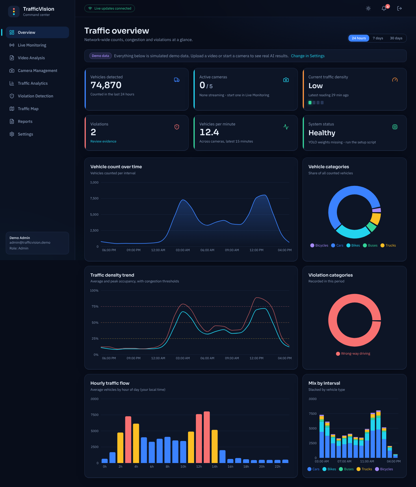

# TrafficVision AI

An AI traffic-monitoring platform: upload traffic videos or connect a camera and get **YOLO11 vehicle detection, ByteTrack tracking, line counting, congestion levels and evidence-backed violations**, all in a dark "command center" dashboard.

> Portfolio project. Built with FastAPI + OpenCV + Ultralytics YOLO11 + supervision (ByteTrack) on the backend and React + Vite + TypeScript + Tailwind on the frontend.



More screenshots: [docs/screenshots](docs/screenshots/README.md) (captured from the running app with demo data).

## Features

| Area | What it does |
|---|---|
| Detection | Cars, motorcycles ("bikes"), buses, trucks, bicycles with boxes, labels, confidence |
| Tracking | ByteTrack IDs that persist across frames, so a vehicle is counted once |
| Counting | Multiple configurable counting lines, in/out direction, counts per category, duplicate-free |
| Density | Occupancy of configurable zones -> Low / Moderate / High / Critical (thresholds editable) |
| Video analysis | Upload MP4/AVI/MOV, background processing, progress, pause / resume / stop, live annotated preview, downloadable annotated H.264 video |
| Live monitoring | Browser webcam, server webcam, RTSP/HTTP stream or recorded sample video; MJPEG + WebSocket stats |
| Violations | Wrong-way, restricted-zone, overspeed (calibrated), red-light (configured signal + stop line). Screenshot evidence, severity, search/filter, CSV |
| Analytics | Traffic flow, class mix, density trend, hourly profile, peak periods, heatmap + movement paths, detection history |
| Reports | Daily / weekly / monthly PDF, traffic + violation CSV |
| Platform | JWT auth, roles (viewer/operator/admin), activity log, notifications + WebSocket alerts, system health, dark/light theme, responsive UI, Docker |

### Honesty rules built into the product
* **Demo data is always labelled** `DEMO` and can be switched off (Settings -> Appearance and data). Heatmaps, movement paths and detection history come **only** from real AI processing.
* **A violation is only raised when its prerequisites are configured** (zone / signal + stop line / calibration). Ordinary movement is never labelled a violation.
* **Red-light detection reads a configured signal state** (manual or fixed cycle) - it does not recognise the colour of a traffic light in the image.
* **Speed from one camera is an estimate** (see [docs/CV_PIPELINE.md](docs/CV_PIPELINE.md#speed-estimation-limits)).

## Quick start (Windows, VS Code)

Prerequisites: **Python 3.10-3.12** (tick "Add to PATH"), **Node.js 18+**, ~3 GB free disk (PyTorch).

```powershell
# 1. open the extracted folder in VS Code, open a terminal (Ctrl+`) and run:
powershell -ExecutionPolicy Bypass -File scripts\setup.ps1

# 2. start backend + frontend (two windows)
powershell -ExecutionPolicy Bypass -File scripts\run-all.ps1
```
Open **http://localhost:5173** and sign in with the demo account below.
In VS Code you can also use *Terminal -> Run Task -> Run everything* (`.vscode/tasks.json`).

Manual commands (what the scripts do):

```powershell
# Backend  (terminal 1)
cd backend
python -m venv .venv
.\.venv\Scripts\python.exe -m pip install -r requirements-dev.txt
cd ..
copy .env.example .env
backend\.venv\Scripts\python.exe scripts\download_weights.py      # YOLO weights (~6 MB)
cd backend
.\.venv\Scripts\python.exe -m uvicorn app.main:app --reload --port 8000   # API docs: http://localhost:8000/docs

# Frontend (terminal 2)
cd frontend
npm install
npm run dev                                                         # http://localhost:5173
```

Linux/macOS: `bash scripts/setup.sh`, then `uvicorn app.main:app --reload` in `backend/` and `npm run dev` in `frontend/`.

### Demo credentials (local use only)
| Role | Email | Password |
|---|---|---|
| Admin | `admin@trafficvision.demo` | `Admin@12345` |
| Operator | `operator@trafficvision.demo` | `Operator@12345` |

Self-registered accounts are **viewers** (read-only); an admin can promote them in Settings -> Users and activity. For any shared/hosted deployment set `SEED_DEMO_DATA=false` or change the demo passwords in `.env`.

## How to run a video analysis
1. **Video Analysis** -> drag in an MP4/AVI/MOV (a fixed, slightly elevated road view works best).
2. Optionally choose a camera's *Detection setup* (counting lines / zones) or keep the default (one counting line at 60 % of the frame height).
3. **Start analysis**. Watch the live annotated preview and counters; pause / resume / stop as needed.
4. When done: counts per type, per line, peak congestion, violations, heatmap + movement paths, and a **Download annotated video** button.
5. Draw your own lines and zones in **Settings -> Cameras and zones** (click on a frame of the video), save, and process again.

No video? See [sample_data/README.md](sample_data/README.md) for free sources and for registering a recorded clip as a "camera".

## Technology stack
Frontend: React 18, Vite, TypeScript, Tailwind CSS 3, Framer Motion, Recharts, Lucide, React Router, Axios, Leaflet/React-Leaflet (OpenStreetMap tiles need internet).
Backend: Python, FastAPI, Pydantic v2, SQLAlchemy 2, WebSockets, JWT (PyJWT) + bcrypt, ReportLab (PDF).
Computer vision: OpenCV, PyTorch, Ultralytics YOLO11, ByteTrack via `supervision` 0.25.1, NumPy, bundled ffmpeg (imageio-ffmpeg) for H.264 output.
Data: SQLite (default) or PostgreSQL. Ops: Docker, Docker Compose, Vercel (`frontend/vercel.json`), Render (`render.yaml`).

## Architecture
```
 Video file / webcam / RTSP / browser frames
        |
        v
 FastAPI  --(background worker threads)-->  CV pipeline
  REST + WebSocket                           frame -> YOLO11 detect -> ByteTrack
        ^                                           -> line counting / density
        |                                           -> violation engine -> evidence JPEG
        |                                           -> DB rows (SQLAlchemy) + WS events
        v
 React dashboard  <-- REST (charts, tables, reports) / WS (live stats, alerts) / MJPEG (live video)
```
More detail: [docs/ARCHITECTURE.md](docs/ARCHITECTURE.md). API list: [docs/API.md](docs/API.md) (interactive version at `/docs`).

## Project layout
```
backend/app/{api,core,models,schemas,services,cv,workers}   FastAPI app, CV code, background workers
backend/tests                                                pytest suite (29 tests)
frontend/src/{components,pages,layouts,hooks,services,context,types,utils}   React app (+ src/test)
scripts/        setup / run / download_weights / test scripts (PowerShell + bash)
docs/ sample_data/ Dockerfile docker-compose.yml render.yaml .env.example
```

## Model weights
Weights are not committed. `scripts/download_weights.py` fetches `yolo11n.pt` (default) into `backend/models/`. For better accuracy use `python scripts/download_weights.py yolo11s.pt` and set `YOLO_MODEL=yolo11s.pt` in `.env`. If weights are missing the API answers `503` with this instruction and the System health page shows "Missing" - the app never crashes.

### GPU acceleration (optional)
`DEVICE=auto` uses CUDA when PyTorch can see it. On Windows `pip` installs a CPU-only PyTorch by default; for an NVIDIA GPU install the CUDA build first (see https://pytorch.org/get-started/locally/), e.g. `pip install torch torchvision --index-url https://download.pytorch.org/whl/cu124`, then the rest of the requirements.

## Docker
```bash
cp .env.example .env        # set SECRET_KEY (and change demo passwords)
docker compose up --build   # UI + API on http://localhost:8000, PostgreSQL included
```
The image installs CPU PyTorch and downloads the weights at build time. Docker cannot reach a physical webcam on Windows/macOS - use video upload, stream URLs or the **browser webcam** camera type.

## Testing
```powershell
scripts\run-tests.ps1         # or: cd backend && python -m pytest ; cd frontend && npm run typecheck && npm test
```
See [docs/TESTING.md](docs/TESTING.md) for exactly what is covered and what was **not** verified.

## Troubleshooting
| Problem | Fix |
|---|---|
| `503 ... YOLO weights not found` | `python scripts/download_weights.py`, restart the backend |
| `running scripts is disabled` | Use `powershell -ExecutionPolicy Bypass -File ...` |
| `pip` fails installing torch | Use Python 3.10-3.12 (64-bit); upgrade pip; ensure ~3 GB free |
| Frontend shows "Cannot reach the backend" | Start the backend first (port 8000). Check `http://localhost:8000/api/health` |
| Port 8000 / 5173 in use | Stop the other process or change the port (`--port`, `vite --port`; set `VITE_PROXY_TARGET`) |
| Browser webcam does nothing | Allow camera permission for `localhost`; close apps using the camera (Zoom/Teams) |
| Server webcam "could not open" | Check the device index (0/1), Windows *Privacy -> Camera -> desktop apps*, close other apps |
| Annotated video won't play in the browser | It is H.264 via bundled ffmpeg; if re-encoding failed the **Download** button still works (play in VLC) |
| Map tiles are grey | OpenStreetMap tiles need internet access |
| Slow processing | Use "Every 2nd/3rd frame", smaller inference size (Settings), `yolo11n.pt`, or a GPU |
| First start takes a few seconds | Demo data is generated once (about 14,000 analytics rows) |
| Reset everything | Stop the backend, delete `backend/data/`, start again |

## Limitations (please read)
* **Real YOLO inference was not executed in the build environment** (PyTorch could not be installed there). All pipeline logic - ByteTrack, counting, density, violations, video I/O, API, WebSockets - was tested with a scripted detector standing in for YOLO. The YOLO wrapper (`backend/app/cv/detector.py`) is a thin call to Ultralytics `predict` + `sv.Detections.from_ultralytics`. Run one real traffic video on your machine first and check the counts against what you see. See [docs/TESTING.md](docs/TESTING.md).
* PostgreSQL support and the Docker / Vercel / Render files were written but **not executed** here.
* No physical camera/CCTV was available: webcam and RTSP paths are implemented but not exercised against real devices.
* Accuracy depends on camera angle, resolution, lighting and model size; small/occluded vehicles and night footage are harder. Counting-line placement matters.
* Overspeed is indicative only; red-light uses a configured signal; wrong-way/restricted need hand-drawn zones.
* Evidence screenshots are not tamper-proof legal evidence.

## Future improvements
License-plate recognition (ANPR); automatic traffic-light colour detection; perspective (homography) speed calibration; multi-camera re-identification; alembic migrations; background job queue (Celery/RQ) for horizontal scaling; per-camera schedules; email/SMS/Slack alerts; TensorRT/ONNX export for edge devices.
