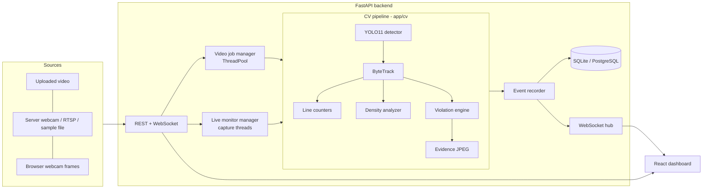

# Architecture

## Key decisions
* **Inference never blocks the event loop.** Video jobs run in a `ThreadPoolExecutor`; each live camera has its own capture thread; browser-webcam frames are processed with `run_in_executor`. Worker threads publish to WebSockets through `asyncio.run_coroutine_threadsafe`.
* **One inference at a time.** `YoloDetector` serialises `predict` calls with a lock (CPU/GPU are shared) and loads the model lazily, so the API starts even when weights are missing.
* **Detector is an interface** (`Detector.detect -> sv.Detections`). Tests inject a scripted detector, everything downstream is real.
* **ByteTrack** (`supervision.ByteTrack`): detections are requested down to score 0.1 so the second association stage can recover occluded vehicles; a track is *activated* only by detections above the user's confidence threshold.
* **Normalised geometry.** Lines/zones are stored as 0..1 coordinates per camera (`Camera.config` JSON, validated by Pydantic), so they survive resolution changes.
* **Counting** (`cv/counting.py`): a vehicle counts once per line when its movement segment crosses the line *segment*; back-and-forth jitter never double counts. Total count = unique vehicles that crossed any line (or unique tracks when no line is set).
* **Analytics** are time-bucketed rows (`traffic_analytics`): 10 s buckets for videos (anchored at processing start), 60 s for live, 15 min for demo data. All charts aggregate these rows in Python so SQLite and PostgreSQL behave identically.
* **Demo vs real.** `is_demo` flags every simulated row; a global `demo_mode` setting filters them out of every query.
* **Security.** JWT bearer auth; bcrypt; roles viewer < operator < admin enforced by dependencies; upload extension + MIME + magic-byte + size checks, random server-side filenames; path traversal guarded by `safe_join`; media endpoints require a token (query token because `/<video>` cannot send headers); CSV export neutralises formula injection; SECRET_KEY mandatory in production.

## Database (SQLAlchemy models, `backend/app/models/entities.py`)
`users`, `cameras`, `video_uploads`, `detection_records`, `vehicle_counts`, `violations`, `traffic_analytics`, `system_settings`, `activity_logs`, `notifications` - with foreign keys (cascade delete from videos/cameras), timestamps and indexes on time and category columns. Tables are created at startup (`create_all`); add Alembic for production migrations.

## WebSocket channels
| Path | Messages |
|---|---|
| `/ws/traffic?token=` | `live_stats`, `video_progress`, `video_status`, `camera_status` |
| `/ws/alerts?token=` | `violation`, `congestion` |
| `/ws/webcam?camera_id=&token=` | client -> binary JPEG; server -> `{type:"frame", image(base64), stats}` |
