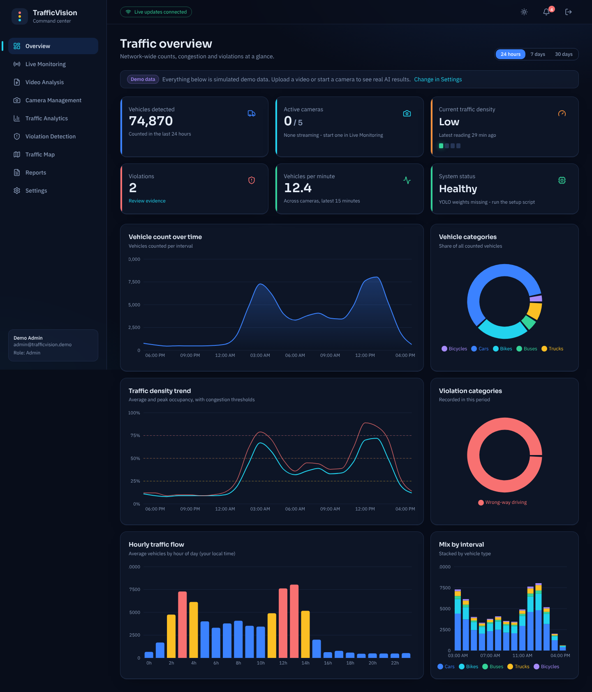
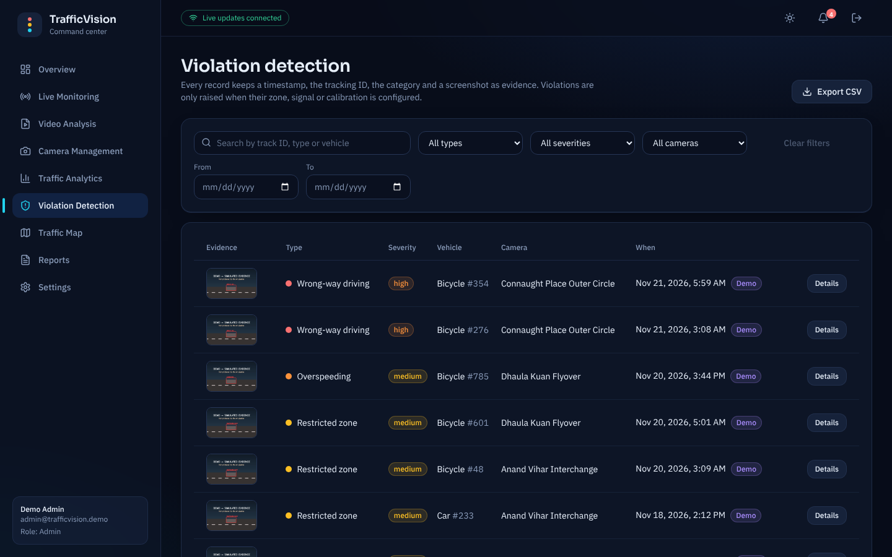
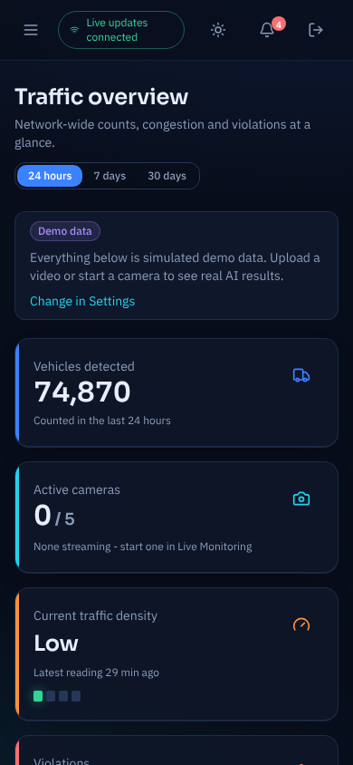
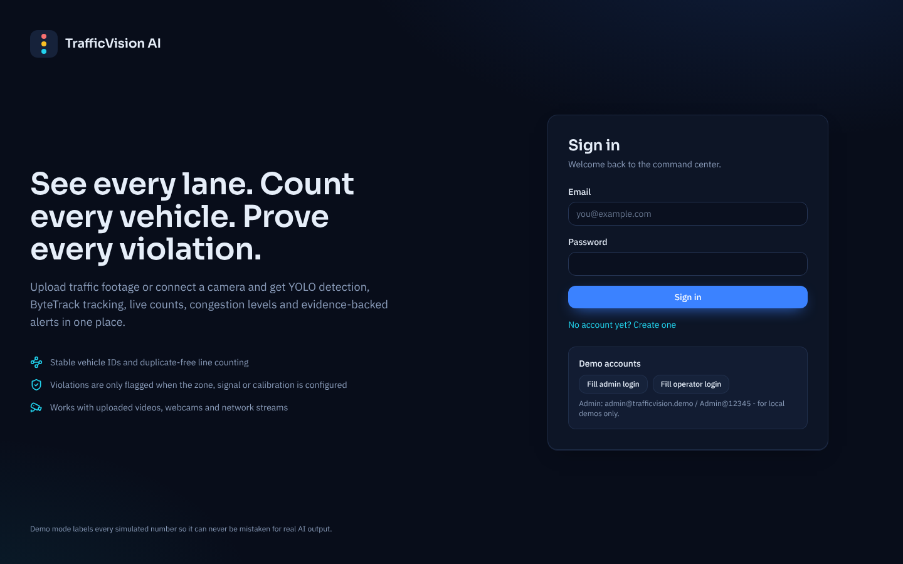

# Screenshots

Captured from the running app (demo data on). `overview.png`, `violations.png`, `login.png`, `mobile.png`.
Replace/add your own after running a real video through the pipeline (Live Monitoring, Video Analysis, Analytics heatmap).

